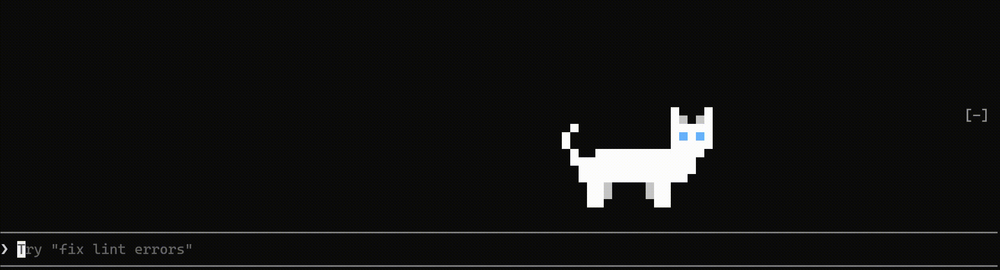

# cutie-neko

A Claude Code mod that puts a small white pixel cat above the prompt in the terminal.

## Example



## What it does

- The cat walks back and forth, with a short sit and a blink now and then.
- Every tool call Claude makes drops a fish (`><>`); the cat walks over and eats it.
- The spinner uses cat words (`Chasing the red dot =^.^=`), the line that closes a turn reads like `Purred for 3s`, and the hint line under the prompt ends in `~ meow`.
- `/cat` puts the cat away or lets it out again, and says how many fish it has eaten.

The cat is drawn in the terminal only. It uses the terminal's own background, and looks best on a dark one.

## Install

At the prompt of a Claude Code terminal session:

```
/plugin install cutie-neko --marketplace xzhiyouu62/cutie-neko
```

Answer `y` to add the marketplace, then pick a scope. From a shell, the same thing is:

```
claude plugin install cutie-neko --marketplace xzhiyouu62/cutie-neko
```

Made and tried on Claude Code 2.1.325.

## Change the cat

The sprites are at the top of `hooks/register.ts`, one letter a pixel: `W` white fur, `S` shaded fur, `E` eye, `.` nothing. The colors are in `INK` just above them.
